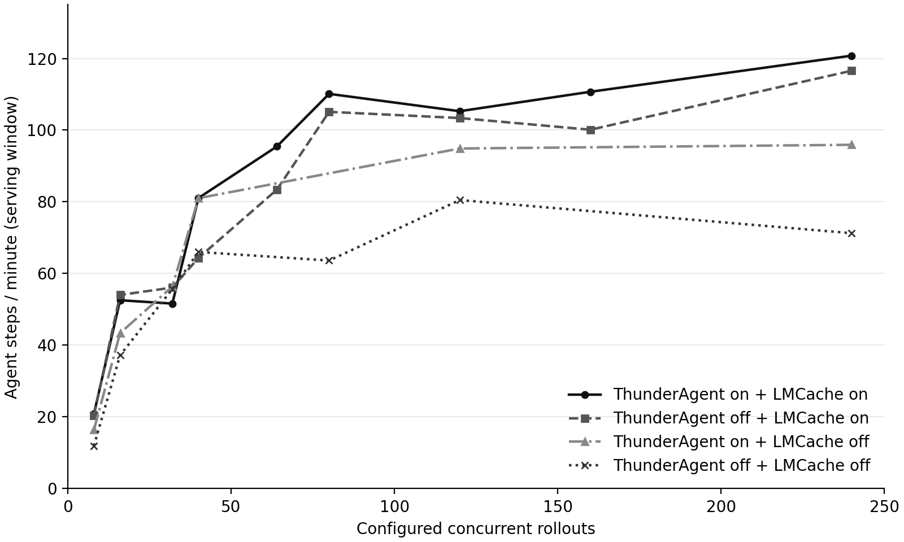
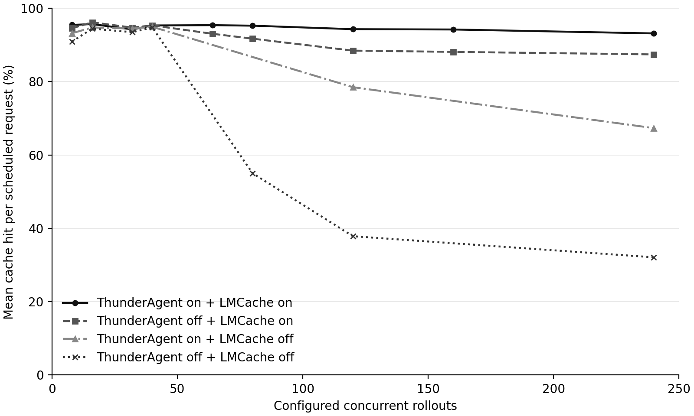
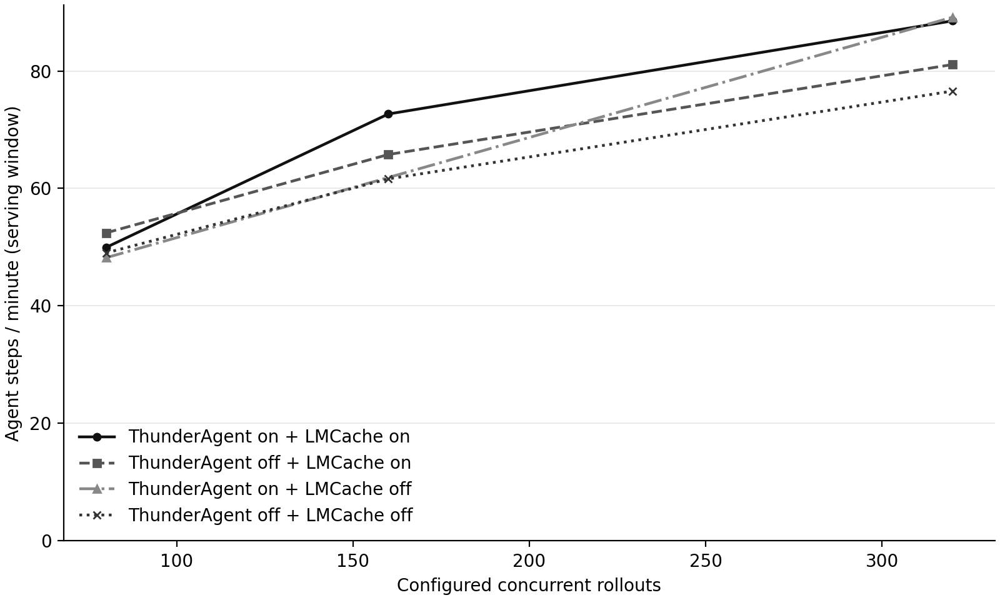
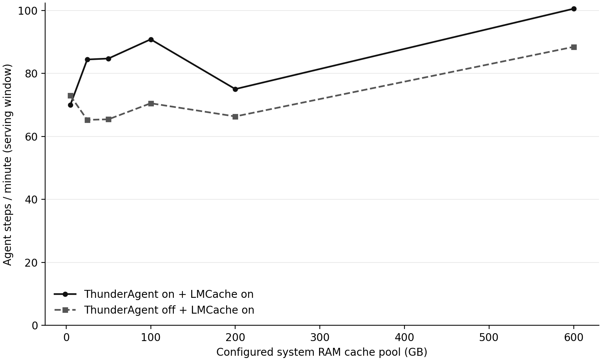
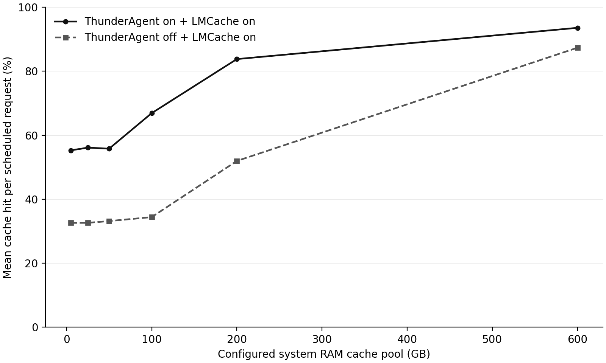

An agent's next model call often repeats most of its previous one. The conversation carries forward the task, earlier answers, and tool results. Reusing the KV state for that history can save prefill work, provided it survives until the next turn.

That proviso matters when generating many rollouts at once. Each trajectory accumulates context, while GPU memory must hold model weights and the KV working set of other trajectories. A prefix that was useful a moment ago may have lost its place by the time its agent returns from a tool call.

We tested mini-SWE-agent rollouts through SkyRL and vLLM, adding **[ThunderAgent](https://github.com/ThunderAgent-org/ThunderAgent)** for program-aware routing and scheduling and **[LMCache](https://lmcache.ai/)** for KV retention in system RAM. We found that combining them improved rollout throughput in our Qwen3-14B workload: at 240 configured concurrent rollouts, the combination delivered **70% higher throughput than the vLLM baseline**, 26% higher than ThunderAgent alone, and 3.6% higher than LMCache alone.

## Methodology

**ThunderAgent** enables program-aware routing and admission control. It directs follow-up turns toward an engine with useful prefix state and can pause programs under memory pressure. We evaluate its routing and scheduling together.

**LMCache** enables the multi-process KV connector and a shared system RAM pool. During inference, the connector asynchronously stores newly available full KV chunks from GPU to system RAM. When a later request can reuse a saved prefix absent from GPU cache, it asynchronously loads that KV back. These transfers use GPU-to-host bandwidth alongside inference. GPU prefix caching remains enabled in all configurations.

We compared four serving configurations for rollouts generated through SkyRL:

| Configuration | ThunderAgent | LMCache system RAM store |
|---|:---:|:---:|
| Config 1 | on | on |
| Config 2 | off | on |
| Config 3 | on | off |
| Config 4 | off | off |

**Config 1: SkyRL through the ThunderAgent proxy, with LMCache.** ThunderAgent routes requests to vLLM and controls program admission. The engines share a system RAM store through LMCache, allowing later turns to recover prefixes absent from GPU cache.

**Config 2: SkyRL with vLLM and LMCache.** Requests reach vLLM without ThunderAgent's program-aware scheduling. LMCache supplies the shared system RAM store.

**Config 3: SkyRL through the ThunderAgent proxy, without LMCache.** ThunderAgent manages placement and admission, while reuse depends on vLLM's GPU prefix cache. There is no system RAM store to recover a prefix once it leaves GPU cache.

**Config 4: SkyRL with baseline vLLM.** Neither ThunderAgent nor LMCache is enabled. A follow-up request reuses its prefix if it reaches an engine that still holds the KV on GPU; otherwise those tokens need prefill again.

The non-ThunderAgent HTTP path includes a profiling proxy. In the current implementation, it hashes the task and sample IDs to keep a rollout's turns on the same engine, with round-robin as a fallback when those IDs are absent. The proxy's routing policy was intended to mimic baseline SkyRL scheduling.

The primary experiment uses Qwen3-14B BF16 with two independent model replicas (DP=2, TP=1), one per H100 80 GB GPU, and a 600 GB shared system RAM cache allocation. Rollouts use mini-SWE-agent through SkyRL on SWE-bench Verified: each task is a repository issue, and the agent inspects and edits code by executing shell commands in a sandbox.

We generate eight samples per task, with up to 50 turns, a 16,384-token input limit, and up to 4,096 generated tokens per call. These are generation-only serving experiments, without GRPO policy updates. Configured concurrency is tasks times samples: 30 tasks gives 240 configured concurrent rollouts.

**Throughput** is agent steps per minute: unique successfully scheduled `(prompt, sample, turn)` tuples divided by elapsed minutes from the first execution start to the last request finish. This rollout serving window excludes startup and teardown but includes tool waits, scheduling delays, and the workload's ramp-up and drain.

**Cache hit rate** is the mean per successfully scheduled request of cached prompt tokens divided by prompt length. GPU hits and LMCache CPU hits (KV retrieved from system RAM) are reported separately and add to the total. Requests receive equal weight, so these are not token-weighted totals across the run. Allocation failures are excluded from this hit-rate average, while their delays remain in elapsed time.

## Offload benefit scales with concurrency

*Qwen3-14B throughput versus configured concurrent rollouts. The offload configurations sustain higher throughput as concurrency grows; ThunderAgent + LMCache reaches 120.8 steps/min at 240 concurrent rollouts. [Configuration key](#configurations).*

At 240 configured concurrent rollouts, the throughput and cache measurements are:

| Configuration | Steps/min | GPU hit | CPU hit | Total hit |
|---|---:|---:|---:|---:|
| ThunderAgent on + LMCache on | **120.8** | 55.3% | 37.9% | **93.2%** |
| ThunderAgent off + LMCache on | 116.6 | 29.0% | 58.4% | 87.4% |
| ThunderAgent on + LMCache off | 95.9 | 67.3% | 0% | 67.3% |
| ThunderAgent off + LMCache off | 71.2 | 32.1% | 0% | 32.1% |

ThunderAgent alone improves GPU reuse substantially: at this setting, the mean GPU hit rate rises from 32.1% to 67.3%. Adding LMCache to ThunderAgent raises measured throughput by **26%** and recovers KV through the system RAM store. Compared with the baseline of bare SkyRL and vLLM, the combined configuration is **70% faster** in the serving window.

The incremental gain over LMCache only is much smaller: **3.6%**. These measurements support a benefit from offload under growing memory pressure; they do not establish that adding ThunderAgent always improves an offloaded system.

## Scheduling and offload symbiosis

*Qwen3-14B mean cache hit rate versus configured concurrent rollouts. ThunderAgent + LMCache maintains a mean cache hit rate above 93% across the plotted settings, while GPU-only reuse falls at higher concurrency. [Configuration key](#configurations).*

Scheduling controls which programs continue to compete for GPU capacity. Offload preserves reusable state when that state no longer resides on GPU. Their useful interaction is the handoff, where a program can yield capacity and be placed on the pause queue without necessarily paying the full prefill cost when it returns.

The Qwen logs contain both program pause and resume events, and the combined run records a substantial CPU hit contribution. At 240 configured concurrent rollouts, adding ThunderAgent to LMCache shifts reuse toward GPU: the mean GPU hit rate rises from 29.0% to 55.3%, while the CPU contribution falls from 58.4% to 37.9%. This is consistent with a division of work in which ThunderAgent maintains locality and limits active pressure, while LMCache supplies state absent from GPU.

Our original hypothesis was that the two would complement each other: let ThunderAgent make room for other programs, and let LMCache recover useful KV when a program returns. We see pauses, resumes, and CPU hits in the logs. The contribution of pause/resume recovery to the observed speedup remains to be measured. Establishing it requires tracing GPU block eviction and subsequent retrieval across program pauses, since pausing does not necessarily evict KV immediately.

Studying a smaller model relative to available GPU memory lets us examine how growing rollout contexts create cache pressure even when model weights leave substantial room for KV. To see how that regime changes with a larger model used for agentic tasks, we also tested GLM-4.6V-FP8. Its KV layout and memory footprint, together with the different parallelism configuration, change both the available cache capacity and the tradeoff between loading KV and recomputing it.

We also measured GLM-4.6V-FP8 with four engines at TP=2, using eight H100 80 GB GPUs.

*GLM-4.6V-FP8 throughput versus configured concurrent rollouts. At 320 concurrent rollouts, ThunderAgent with and without LMCache reaches similar throughput, both ahead of the vLLM baseline. [Configuration key](#configurations).*

At 320 configured concurrent rollouts:

| Configuration | Steps/min | Total hit |
|---|---:|---:|
| ThunderAgent on + LMCache on | 88.5 | **90.7%** |
| ThunderAgent off + LMCache on | 81.1 | 86.0% |
| ThunderAgent on + LMCache off | **89.2** | 63.8% |
| ThunderAgent off + LMCache off | 76.6 | 24.4% |

ThunderAgent + LMCache has the highest cache hit rate, but ThunderAgent alone is slightly faster here: 89.2 steps/min versus 88.5 with LMCache, a gap of less than 1%. Adding LMCache raises the mean hit rate from 63.8% to 90.7% without improving throughput at this setting. Better reuse doesn't automatically mean better throughput; transfers and scheduling have a cost too.

## How much does a system RAM cache help?

We also varied the configured system RAM cache pool from 5 to 600 GB at a fixed 200 configured concurrent Qwen rollouts. These are separate runs from the concurrency sweep.

*Qwen3-14B throughput versus system RAM cache capacity at 200 configured concurrent rollouts. Both configurations reach their highest measured throughput at 600 GB, though the intermediate results are not monotonic. [Configuration key](#configurations).*

*Qwen3-14B mean cache hit rate versus system RAM cache capacity at 200 configured concurrent rollouts. Larger system RAM pools retain more reusable KV: ThunderAgent + LMCache rises from 55.3% mean cache hit rate at 5 GB to 93.6% at 600 GB. [Configuration key](#configurations).*

With ThunderAgent + LMCache, total hit rate rises from 55.3% at 5 GB to 93.6% at 600 GB. The CPU contribution is only 0.3% at 5 GB and reaches 38.2% at 600 GB. A small pool provides little reuse in this workload.

Throughput is noisier: ThunderAgent + LMCache measures 70.0 steps/min at 5 GB and 100.6 at 600 GB, but drops from 90.8 at 100 GB to 75.0 at 200 GB. We see more reusable KV retained with a larger pool; we don't see a clean throughput scaling law or an established capacity threshold.

## Discussion

Our strongest finding is that **retaining KV in system RAM can improve throughput in workload regimes where rollout contexts outgrow GPU cache and retrieval costs less than recomputation**. The benefit depends on context reuse, concurrency, model KV size, and available GPU and system RAM capacity. At 240 configured concurrent Qwen rollouts, adding LMCache to ThunderAgent improved throughput by 26%. Program-aware scheduling can complement that retention: ThunderAgent controls which programs keep moving, while LMCache keeps reusable state available outside GPU memory. Adding ThunderAgent to LMCache produced a smaller and less consistent gain.

Our goal was to explore how program-aware scheduling and KV offload could work together when GPU KV space runs out. We measured rollout serving with fixed weights; repeated experiments within a full RL training loop would be needed to quantify the resulting training speedup. Testing larger, multi-node deployments, where routing and KV transfers introduce additional costs, is a direct next step.

## Acknowledgments

Special thanks to [Hanchen Li](https://hanchenli.github.io/) for his collaboration and mentorship.

## References

1. Shiyi Cao et al. *SkyRL-v0: Train Real-World Long-Horizon Agents via Reinforcement Learning.* 2025. [Technical report](https://novasky-ai.notion.site/skyrl-v0).
2. Hao Kang et al. *ThunderAgent: A Simple, Fast and Program-Aware Agentic Inference System.* 2026. [arXiv:2602.13692](https://arxiv.org/abs/2602.13692).
3. Woosuk Kwon et al. *Efficient Memory Management for Large Language Model Serving with PagedAttention.* SOSP, 2023. [arXiv:2309.06180](https://arxiv.org/abs/2309.06180).
4. Yuhan Liu et al. *LMCache: An Efficient KV Cache Layer for Enterprise-Scale LLM Inference.* 2025. [arXiv:2510.09665](https://arxiv.org/abs/2510.09665).
5. Qwen Team. *Qwen3 Technical Report.* 2025. [arXiv:2505.09388](https://arxiv.org/abs/2505.09388).
6. John Yang et al. *SWE-agent: Agent-Computer Interfaces Enable Automated Software Engineering.* NeurIPS, 2024. [arXiv:2405.15793](https://arxiv.org/abs/2405.15793). Recommended citation for mini-SWE-agent.

